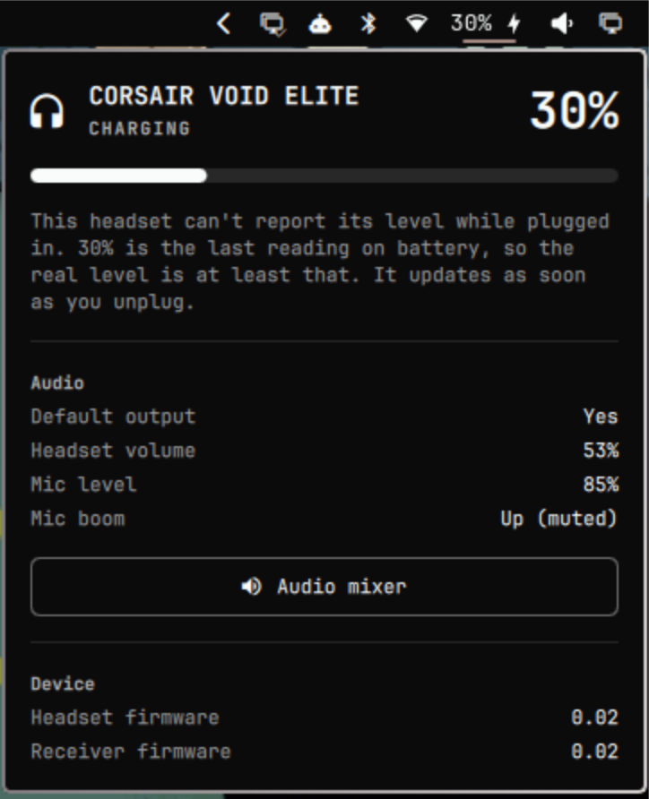

# Headset Battery for Omarchy

A bar widget for the [Omarchy](https://omarchy.org) shell that shows your wireless headset's battery level, plus a panel with the details that matter: charge, volume, mic, and device info.



## Features

- **Battery in the bar.** It shows a headset icon and percentage, with a bolt while charging. The widget turns the warning color when the battery runs low, and hides itself when no headset is connected.
- **Details panel.** Left-click the widget to see:
  - Battery level with a charge bar, and time left if the headset reports it
  - Whether the headset is your default output, with a one-click **Use as output** button
  - Headset volume and mic level
  - Mic boom position (up = muted) and headset/receiver firmware versions, on headsets whose driver reports them (e.g. Corsair Void)
  - An **Audio mixer** button that opens Omarchy's audio panel. Middle-clicking the widget does the same.
- **Honest charging readings.** Some headsets report a false battery level while plugged in. The Corsair Void series, for example, climbs from 20% to "fully charged" in under a minute. By default the widget ignores those readings and keeps showing the last level measured on battery until you unplug. That level is the floor for the real one. See [Settings](#settings) to turn this off.
- **Follows Omarchy.** It uses the theme colors, the shell's panel style and animations, and the keyboard navigation of the built-in panels.

## Compatibility

The widget works with any headset that UPower can see as a headset or headphones. To check yours, run:

```sh
upower -e | grep -Ei 'headset|headphones'
```

If a device is listed, the widget will show it.

- **USB dongle headsets** with a Linux battery driver. This was tested with the **Corsair Void Elite Wireless** (`hid-corsair-void`).
- **Bluetooth headsets** that report their battery to BlueZ. Most recent ones do.

The mic boom and firmware rows only appear for drivers that expose them. Volume and default-output info come from PipeWire and work with any headset.

## Install

```sh
omarchy plugin add https://github.com/jasoncromwell/omarchy-headset-battery --enable
```

The widget appears in the right section of the bar. To move it, for example next to the audio widget:

```sh
omarchy bar move io.github.jasoncromwell.headset-battery --before omarchy.audio
```

### Manual install

```sh
git clone https://github.com/jasoncromwell/omarchy-headset-battery \
  ~/.config/omarchy/plugins/io.github.jasoncromwell.headset-battery
omarchy-shell shell rescanPlugins
omarchy plugin enable io.github.jasoncromwell.headset-battery
```

## Update

```sh
omarchy plugin update io.github.jasoncromwell.headset-battery
```

## Remove

```sh
omarchy plugin remove io.github.jasoncromwell.headset-battery
```

This also takes the widget off the bar. The widget keeps one small file holding the last on-battery reading. To delete it too:

```sh
rm -f "${XDG_STATE_HOME:-$HOME/.local/state}/io.github.jasoncromwell.headset-battery.json"
```

## Settings

Change these from the widget's settings in Omarchy, or with `omarchy bar set`:

| Setting | Default | Description |
|---|---|---|
| `lowThreshold` | `15` | On battery, the widget turns the warning color at or below this percentage. |
| `holdLevelWhileCharging` | `true` | While plugged in, show the last on-battery reading instead of the headset's own report. Turn this off if your headset reports its level correctly while charging. |

```sh
omarchy bar set io.github.jasoncromwell.headset-battery lowThreshold 20
omarchy bar set io.github.jasoncromwell.headset-battery holdLevelWhileCharging false --json
```

## Dependencies

Everything it needs ships with Omarchy, so there's nothing extra to install:

- The Omarchy shell (Quickshell), with its UPower and PipeWire services
- `upower`, which reads charge history when no on-battery reading has been saved yet
- `grep`, `tac`, `head` and `sh` (coreutils), used to read the driver's sysfs files and UPower's history

## Privacy and safety

- The widget makes no network requests.
- It reads battery info from UPower, audio info from PipeWire, and read-only driver attributes from `/sys/class/power_supply/<device>/device/`.
- It writes exactly one file, the state file described above.
- Its only system change is the **Use as output** button, which sets your default audio output through Omarchy's own `omarchy-audio-output-set-default`.
- It needs no root access, never changes your config files, and never runs anything downloaded.

## Troubleshooting

- **The widget doesn't appear.** It hides when no headset is connected. Check with the `upower -e` command above, and make sure the headset is turned on.
- **The level shows a bolt but no number.** The headset was plugged in before the widget ever saw it on battery, and UPower has no history for it yet. Unplug it once to take a reading.
- **Edits to the plugin don't take effect.** Run `omarchy restart shell`.

## License

[MIT](LICENSE) © 2026 Jason Cromwell
